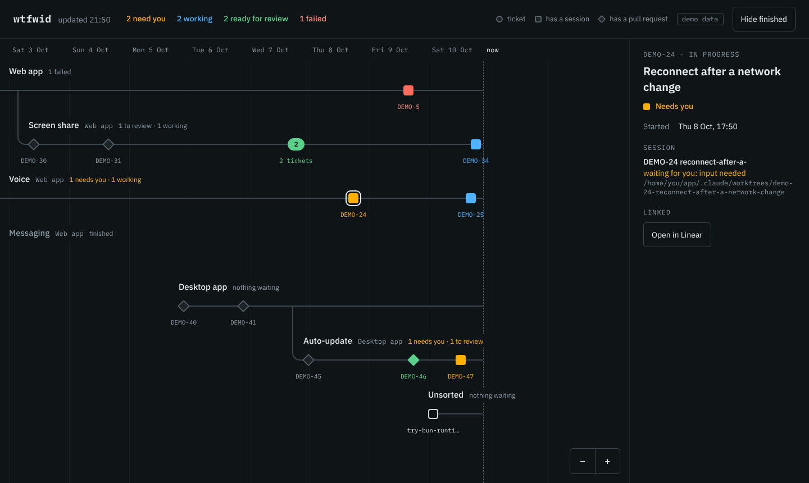

# wtfwid

What the f was I doing.

One screen for everything you have in flight: every ticket you have worked on, on a
timeline, with the state of the Claude Code session and the pull request behind it.



- A line is a Linear project. Its milestones branch off it.
- A node is a ticket. A circle is a ticket alone, a square has a Claude Code session, a diamond has a pull request.
- Colour is state: amber needs you, blue is working, green is ready for review, red failed, faded is done.
- Time runs left to right with no window. Drag to pan, ctrl/cmd + wheel to zoom.
- Tickets too close to draw apart merge into a counted cluster, coloured by the most urgent one in it.

It only reads. It changes nothing in Linear, GitHub or Claude Code.

## Run it

Needs Node 22 and pnpm.

```sh
pnpm install
pnpm desktop     # builds and opens the desktop app
```

Or in a browser: `pnpm dev`.

On first open it asks for your Linear key. (To look around with invented data first, follow
the demo link on that screen.) Everything can be changed later under **Settings**:

| Setting | What it is |
| --- | --- |
| Linear API key | A personal API key. Linear: Settings → Account → Security & Access. |
| Linear team key | The prefix of your issue IDs, e.g. `ENG`. Empty reads every team. |
| GitHub repositories | `owner/repo`, comma separated. |
| GitHub token | Optional. Without one, wtfwid uses `gh auth token`. |

Sessions come from `claude agents --json --all`, so Claude Code has to be installed on the
machine wtfwid runs on.

### Where your keys go

Into `~/.wtfwid/settings.json`, readable only by you. A saved key is never sent back to the
screen; the dialog can only replace or remove it.

- The desktop app encrypts keys with your system keychain. The dialog tells you whether it did.
- On Linux that needs a running keyring (GNOME Keyring or KWallet). On a bare window
  manager Electron does not look for one; start the app with
  `--password-store=gnome-libsecret` to use GNOME Keyring anyway.
- The browser version has no keychain and stores keys without encryption.

A `.env` file still works (see `.env.example`). Saved settings win over it.

### Download it

Installers for Linux (AppImage), Windows and macOS are on the
[releases page](https://github.com/vargaking/wtfwid/releases). Nothing is code-signed, so
Windows and macOS will warn before running it. The Windows and macOS builds come straight
out of CI and have not been run by a person.

A release is published automatically: raise `"version"` in `package.json`, merge to `main`,
and the workflow in `.github/workflows/release.yml` builds all three and publishes them as
`v<version>`.

### Package it yourself

```sh
pnpm dist        # writes an installer for your OS into dist/
```

### Without Electron

`pnpm build && pnpm start` serves the same screen on `127.0.0.1:4173`.

## When something does not show up

Open Settings and press **Check**. It tries Linear, GitHub and Claude Code with the
settings as saved and says what each gave back, and how many sessions ended up on a
ticket. It shows counts only, so you can paste the result into an issue.

## How a session ends up on the right ticket

By branch or by name. A session or pull request belongs to a ticket when its branch, name
or working directory contains the issue identifier (`ENG-123`) or Linear's branch name for
the issue. wtfwid reads the branch a session is on from Claude Code's transcript of it, so
working on the ticket's branch is enough. Naming the session works too:

```sh
claude -n "ENG-123 reconnect loop"
```

Anything that matches no ticket goes on an **Unsorted** line, so nothing running is hidden.

Claude Code only lists sessions that still exist. wtfwid keeps every session it has seen
in `~/.wtfwid/sessions.json`, so they stay on the timeline after they are gone.

## What a session was doing

Open a ticket and each of its sessions shows what it was started with, the last thing you
asked, the last thing Claude said and the pull requests it opened. That comes straight from
Claude Code's transcript of the session, read when you open the ticket. Nothing is written
and no model is called.

From there you can copy the command that resumes a session (`claude --resume …` in its
folder), or copy a prompt that hands a new session everything wtfwid knows about the ticket.

## What it does not do yet

See [SPEC.md](SPEC.md). Every behaviour there has an ID and is marked *stated*, *assumed*
or *open*; the tests name the statements they cover. `pnpm spec` lists the statements no
test names yet. The open ones:

- planning chats on claude.ai as nodes
- a written "decided / still open" summary per session
- branches that start from one specific session
- "same files" links between tickets

## Development

```sh
pnpm test     # unit tests
pnpm check    # types
```
